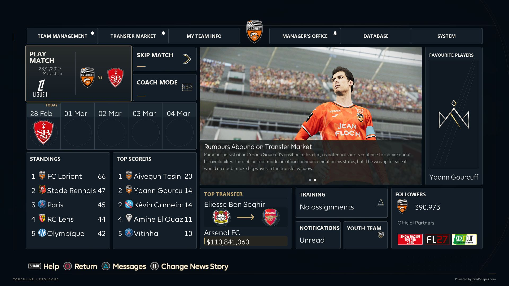
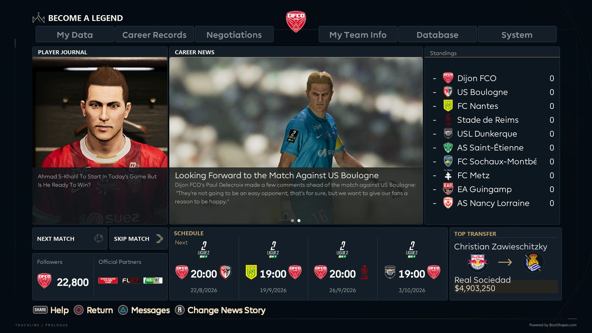
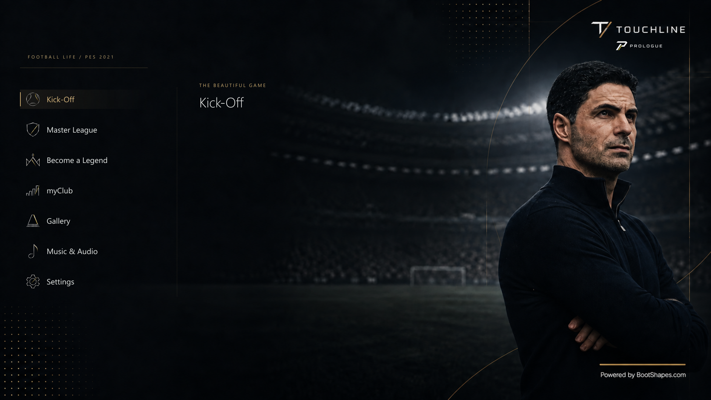
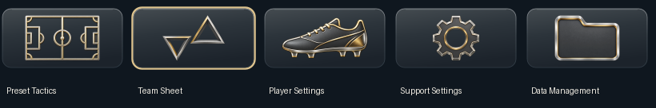
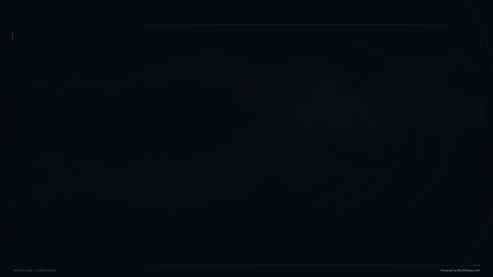

# Touchline Menu for FL 2027

A standalone charcoal, silver and champagne menu mod for **SP Football Life 2027**. It includes the Master League dashboard, portrait main-menu scenes, default Game Plan graphics and `#040B12` information screens.

**[Download the latest release](https://github.com/ahmadsk-cell/Touchline-Menu-FL2027/releases/latest)** · [Installation](#installation) · [Credits](CREDITS.md)







## Included

The optional Classic preview gives the original Master League and Become a Legend menus a Midnight navy theme with platinum borders and champagne accents. In Master League, **Manager’s Office → Touchline** opens the Touchline companion app. In Become a Legend, **Player Menu → Prologue** opens the Prologue companion app. [Download Classic Midnight](https://github.com/ahmadsk-cell/Touchline-Menu-FL2027/releases/download/v2.2.3/Touchline-Menu-FL2027-v2.2.3-classic-midnight-preview.zip) · [Classic installation and uninstall](docs/classic-edition.md)

- Master League dashboard with six tabs, aligned dropdowns, Play Match, Skip Match, Coach Mode, a five-day fixture calendar, standings, top scorers and live news.
- Career cards for the highest observed transfer fee in the active window, training, notifications, youth, followers and Favourite Players. The Favourite Players card shows the selected player’s name and opens the native list.
- A dedicated Become a Legend dashboard with direct My Data and Career Records tabs, native match and skip actions, a Player Journal, standings, schedule, followers with the club crest, and Top Transfer.
- Main menu ordered as Kick-off, Master League, Become a Legend, MyClub, Gallery, Music & Audio, Settings.
- Seven portrait scenes and short introductions for Master League and Become a Legend.
- Dark information backgrounds with subtle smoke, fine gold lines and BootShapes branding.
- Silver-and-gold icons for the default Game Plan menu, negotiations, notifications and calendar events.
- Custom loading, saving and controlled-club indicators, plus the Touchline intro movie.
- Readability changes for league/team rows, team ratings and text-entry dialogs.
- The latest working Schedule and text-input files from the author's installation.





## Requirements

- Windows with **SP Football Life 2027** and **Sider 7.3.3 or newer**, with LiveCPK and Lua enabled.
- English game text. This package includes an English string-table override.

All required theme files, fonts, secondary menu assets and the color component are included. Football Life and Sider themselves are not bundled. This build targets FL 2027. The installer checks for a 64-bit `FL_2027.exe` and a unique supported UI palette before changing files. PES 2021, VirtuaRed/UML and other Football Life versions are outside this release's compatibility scope.

Touchline and Prologue gameplay and story systems are separate projects. No external menu pack or separate UIColors install is required.

## Installation

1. Close Football Life and Sider.
2. Download the English, Spanish, or French **v2.2.4** ZIP from [GitHub Releases](https://github.com/ahmadsk-cell/Touchline-Menu-FL2027/releases/latest) and extract it completely. For a localized preview, select the matching text language in the game.
3. Double-click **Install.cmd** and enter the full path to your **SiderAddons** folder, the folder containing `sider.ini`.
4. Start Sider and Football Life again.

Alternatively, from PowerShell in the extracted package:

```powershell
powershell.exe -NoProfile -ExecutionPolicy Bypass -File .\Install.ps1 -SiderDir 'D:\SP Football Life 2027\SiderAddons'
```

Replace the example path with your installation. Administrator privileges are normally unnecessary if you can write to that folder.

The installer verifies the package, backs up affected files and enables the `TouchlinePrologue2` LiveCPK root, the dashboard and the color module. It enables Sider's LuaJIT extensions and replaces any active dashboard preview or `MLMenuLayoutTrial.lua` entry. Uninstall restores the previous configuration.

The installer creates its backup under `SiderAddons\TouchlineMenu-backups` before writing menu files or Sider settings. If backup creation fails, check that `SiderAddons` is writable and that `TouchlineMenu-backups` is a folder if it already exists. For an FL 2027 installation on Desktop or in OneDrive, check **Windows Security → Protection history** for a blocked write. If Windows blocked the write, use an FL 2027 installation in a writable games folder outside Desktop and OneDrive.

To use the theme with the stock career layout, close Sider and the game, then comment out `lua.module = "TouchlineMLDashboard.lua"` in `sider.ini`.

In Become a Legend, open **Team Info → Player Menu** for the original training, messages and player requests, or **System → Forward Time** for the original time controls.

When upgrading an existing setup, the installer comments out the old MenuC1987, UIColors and TouchlinePrologue roots and the separate `UIColors.lua` module to avoid duplicate menu/palette loading. Their files remain on disk, and uninstall restores the original settings. The stock `switcher\SPcolor.lua` module is also commented out because it overwrites four entries of the theme palette. Its file stays installed, and uninstall restores the original configuration. Other Sider settings, mods and saves are preserved.

Earlier development versions used the same `TouchlinePrologue2` folder. The installer backs them up and removes the obsolete `teamPower.bin` override only when its hash matches a known development copy. An independently edited copy is left for you to resolve.

## Restore the previous setup

Each installation prints its backup directory under `SiderAddons\TouchlineMenu-backups`. Close the game and Sider, then run:

```powershell
powershell.exe -NoProfile -ExecutionPolicy Bypass -File .\Uninstall.ps1 -SiderDir 'D:\SP Football Life 2027\SiderAddons' -BackupDirectory 'D:\SP Football Life 2027\SiderAddons\TouchlineMenu-backups\YOUR-BACKUP-FOLDER'
```

This restores overwritten files and settings and removes files created by that installation. It stops if a file has changed since installation, so later edits are not silently lost. Keep the extracted package and backup until you no longer need to restore them.

## Compatibility and troubleshooting

- **No visual changes:** restart both Sider and the game; confirm `TouchlinePrologue2` and `TouchlineMenuColors.lua` are enabled, with LiveCPK and Lua enabled.
- **Master League uses the stock layout:** check `sider.log` for `MLLAYOUT` entries. The dashboard checks executable signatures at runtime and falls back on unsupported builds. Include those log lines and your FL 2027 version when reporting an issue.
- **Schedule or a text-entry screen is blank:** use this complete release, not an older development ZIP. If another mod overrides the same files, check LiveCPK priority. Report the game version and active menu mods with a screenshot.
- **Different icons during a licensed competition:** the premium Game Plan set targets the default menu. Competitions can provide their own menu layouts and icons.
- **Other menu mods:** they can override the same files or runtime colors. Use one default menu theme at a time. The installer backs up existing theme files and settings; it does not merge other menu layouts.
- The intro overrides `movie/intro/FL2027.usm`. Competition-specific intro movies remain controlled by the existing setup.

Compatibility checks use the supplied FL 2027 executable (file version 27.0.0.0, installed game version 27.1.0). They verify the unique palette signature, the `FL2027.usm` startup movie reference, and the unchanged title-screen layout. Installer/restore tests and a LuaJIT palette initialization/reload test are included. The aligned title screen, portrait main menu, career load list, dark information background and Game Plan screen were also observed in a live session. The final English table was verified record by record. Intro playback has not been fully observed. See `VERIFICATION.json` for the precise scope. Competition-specific themes and additional menu servers can override the default theme.

## Repository and packaging

The repository includes the install-ready dashboard and theme, portable scripts, previews, five high-resolution Game Plan icon masters and the editable information-background SVG. The release ZIP is the easiest download for players. `DEPENDENCY-AUDIT.json` records the sources of the consolidated files.

To verify and package the checked-in release using Python 3:

```text
python tools/package_release.py
```

The ZIP and its SHA-256 checksum are written to `dist/`. No extraction of your game, local credentials or personal save data is required.

See [CREDITS.md](CREDITS.md) for the underlying menu work and tools, and [CHANGELOG.md](CHANGELOG.md) for release notes.
